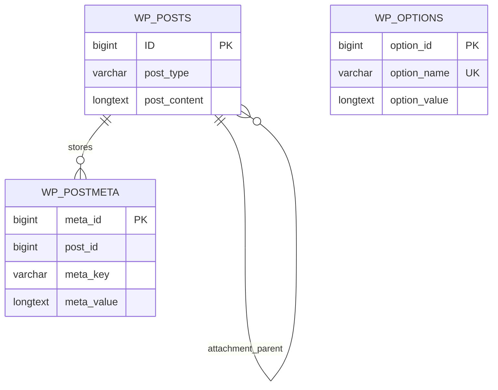

# Storage schema — Portare Product Gallery 0.4.0 candidate

The 0.1.3 admin shortcode helper is derived from the current product ID and stores no data.

No custom tables, no migration/version option, and no activation data writes. Existing absent or malformed metadata normalizes on read. Settings API stores `ppg_settings`; the main gallery handler writes `_ppg_config`/`_ppg_slides`, and the isolated setup handler writes `_ppg_setup` only on its own marked, nonce-checked product Update.

## Product `_ppg_config`

`PPG::config($product_id)` returns this exact normalized structure:

```php
[
  'enabled' => 0,         // integer 0|1; automatic integration opt-in
  'placement' => 'auto',  // auto|shortcode
  'text_side' => 'left',  // left|right
  'quote_enabled' => 1,   // integer 0|1
  'quote_align' => 'left',// left|center|right
  'autoplay' => 0,        // integer 0|1
  'interval' => 5,        // seconds, bounded 1..120, decimal accepted
  'main_arrows' => 1,     // integer 0|1, main-image overlay navigation
  'thumb_arrows' => 1,    // integer 0|1, thumbnail strip overlay scrolling
]
```

`enabled` gates automatic integration, NOT explicit shortcode rendering. `placement=shortcode` prevents automatic hooks even if enabled. Frontend `data-interval` uses milliseconds; the stored `interval` is seconds.

New arrow flags default to on when absent in older metadata. Both are independent per-product controls. They do not modify attachment associations or descriptions. Thumbnail arrows are hidden when the strip fits, and disabled at scroll boundaries. Autoplay pause/resume is a discreet SVG overlay only for autoplay-enabled products; no bottom toolbar is emitted.

## Product `_ppg_slides`

Ordered list, up to 100 rows, normalized and deduplicated by positive image attachment ID:

```php
[
  ['id' => 123, 'description' => '<p>Rich paragraph</p>', 'x' => 50, 'y' => 50, 'zoom' => 100],
]
```

`x/y` clamp to 0..100 percent; zoom clamps to 100..200 percent. Description allows paragraphs, headings h2/h3/h4, emphasis, lists, blockquotes, span without attributes, and links with href/title. No arbitrary CSS, scripts, images, iframes, or event attributes. WordPress KSES validates allowed link protocols.

A nonempty valid custom list replaces the WooCommerce gallery association list; the product's featured image is still prepended and deduplicated so it remains the initial image. Reordering affects other custom images. Featured-image text always uses the product's full WooCommerce description, regardless of custom text stored for that attachment. Empty custom text falls back to the same full description. With no valid custom rows, use featured image plus WooCommerce gallery IDs. Removing all custom rows therefore restores fallback, not an intentionally empty gallery.

The editor media picker appends and deduplicates. Remove means disassociate from `_ppg_slides`; it never deletes an attachment and never edits `_product_image_gallery` or `_thumbnail_id`. WordPress's native media deletion remains independent.

## Product `_ppg_setup` (0.2.0)

An isolated optional value in the existing `WP_POSTMETA` table; missing values default to disabled. Only `PPG_Setup` writes it on its own marked, nonce/capability-checked product Update. No activation or bulk migration.

| Field | Default | Validation / meaning |
|---|---|---|
| enabled | 0 | integer0/1; independent of main gallery autoplay |
| mode | pictures | pictures / sequence / video |
| images | [] | ordered unique valid raster attachment IDs, maximum4; sequence/export needs2–4 |
| heading | empty | plain text, maximum120 characters |
| caption | empty | plain text, maximum500 characters |
| motion | 0 | integer0/1; optional gentle pan/zoom, not folding synthesis |
| video_id | 0 | valid MP4/WebM Media Library attachment |
| poster_id | 0 | valid raster Media Library attachment |
| replace_illustrations | 0 | explicit opt-in; only valid playable media can request safe runtime replacement |

The sequence duration is fixed15000ms, not separately stored. Selected IDs are logical references, not new physical FKs; deleted or invalid media is rejected/ignored with visible configured-content errors. No cascade deletion is added. Existing core attachment rows and uploads hold generated videos; a successful upload does not write this option or automatically publish the video. The user must save the selection with normal product Update. No recording bytes, provider keys or external URLs are stored in product metadata.

## Wan job options (0.4.0)

No new SQL tables or indexes. WordPress serializes arrays in existing `WP_OPTIONS.option_value`; these are **not JSON columns**. Job options are non-autoloaded. The core unique `option_name` index is used for atomic lock creation; there are no new physical FKs or cascade deletes.

| Option family | Value | Purpose |
|---|---|---|
| `_ppg_ai_job_{job_id}` | serialized job array | Durable render intent, provider task reference and imported result |
| `_ppg_ai_index_{product_id}` | serialized array of job IDs | Product recovery/discovery |
| `_ppg_ai_lock_submit_{scope_hash}` | internal lock state | Product-wide paid-submission exclusion |
| `_ppg_ai_lock_import_{scope_hash}` | internal lock state | Import exclusion/idempotency |

Job fields include `id` (`job_` +16lowercasehex), integer `product_id`/`user_id`, provider `task_id`, bounded plain-text `prompt`, first/last `image_ids`, integer `duration`, enum `resolution`, state, `created`/`updated`, safe error text, `attachment_id` and local result URL. Imported attachments carry `_ppg_ai_job_id` for recovery if the result-row write fails. Scope hashes in lock names are the first32hex characters of SHA-256 over the logical product/job scope. Neither the access key nor recording bytes are stored here. Never expose full internal rows to the browser. Finished history is bounded; active/uncertain paid jobs must remain discoverable until reconciled, not silently expire into a new purchase.

The old aggregate `_ppg_ai_jobs` option belongs to the MiniMax prototype and is retained but not converted into new Wan tasks. Before switching a site with real in-flight legacy jobs, reconcile those jobs separately; do not submit them again. There is no automatic data rewrite on activation. Forward/rollback procedure: `migrations/0.4.0-wan-options.md`.

## `ppg_settings`

All keys are normalized using `PPG::setting_specs()`:

| Key | Default | Accepted values/bounds |
|---|---|---|
| font | inherit | inherit, system, sans, serif (fixed local stacks) |
| copy_width | 30 | 20..60 percent |
| gap | 36 | 0..100 px |
| radius | 32 | 0..100 px |
| thumb_radius | 8 | 0..50 px |
| thumb_gap | 24 | 0..60 px |
| title_size | 22 | 12..80 px |
| text_size | 14 | 10..40 px |
| line_height | 1.8 | 1..3 |
| text_color | #16354b | six-digit hex |
| title_color | #111111 | six-digit hex |
| accent | #7eaf80 | six-digit hex |
| transition | fade | fade, slide, none |
| duration | 250 | 0..2000 milliseconds |
| load_effect | none | none, fade, rise |
| ratio | 1.64 | 0.5..3 |
| text_fade | 1 | integer 0/1 |

No user-authored CSS/font stacks. Root CSS variables follow `docs/plans/build.md`; `text_fade` is emitted additionally as `data-text-fade`.

## Existing WordPress relationships



Table prefix is installation-defined. These are existing core tables, not new tables or new physical foreign keys. Attachment IDs within `_ppg_slides` are logical references, validated on read/save; deleted media is ignored. No cascade deletion is introduced.

## Retention

Deactivate and uninstall retain `ppg_settings`, `_ppg_config`, `_ppg_slides`, `_ppg_setup` and associated setup media. No shared media, product content, WooCommerce gallery metadata, Brizy content, compiled HTML, or quote records are deleted or modified. No reset/delete endpoint exists. Removing retained data manually requires a separate explicit operator decision.
